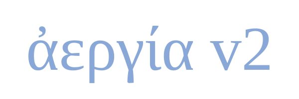

<p align="center">
  
</p>

<p align="center">Aergia is a minimalist and lightweight interpreted programming language.<p>

```py
= greet {:name:
    > ++"Hello, " name "!"
}

= lang "Aergia"
@greet:lang:
```

### Philosophies
1. Every feature must justify its existence.
2. All built-in features must be represented using non-alphanumeric characters.
3. Every feature must follow uniform syntactic and semantic rules.
4. Every feature must be composable with every other feature.

## Getting Started
```sh
pip install git+https://github.com/las-r/aergia
aergia <file.aer>
```

### IDE Support
Aergia v2 has support for the following IDEs:
- [VSCode](https://github.com/las-r/aergia-vscode)