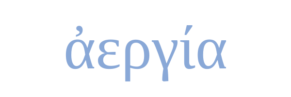

> [!WARNING]
> This branch is for the Aergia v2 rewrite and is a major WIP.

<p align="center">
  
</p>

<p align="center">
  <strong>Aergia</strong> is a minimalist and lightweight interpreted programming language. 
</p>

```py
greet = {:name:
    > "Hello, %name%!"
}

= lang_name "Aergia"
@greet:lang_name:
```